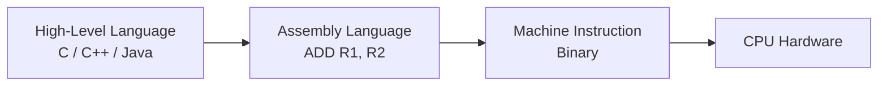
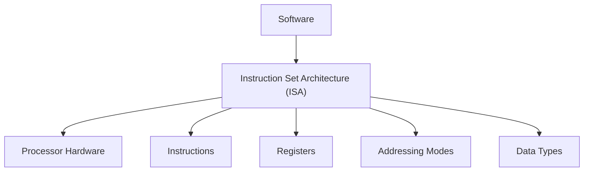
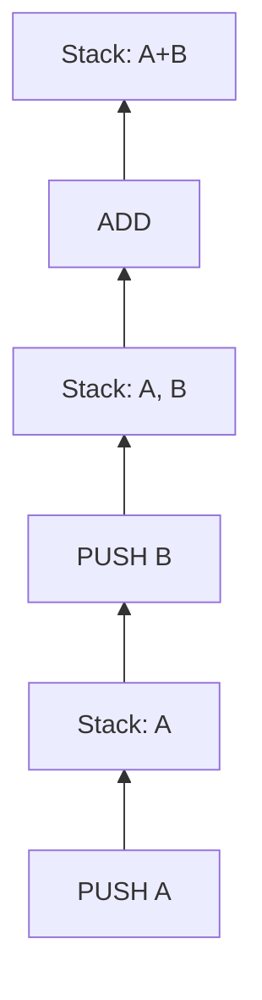
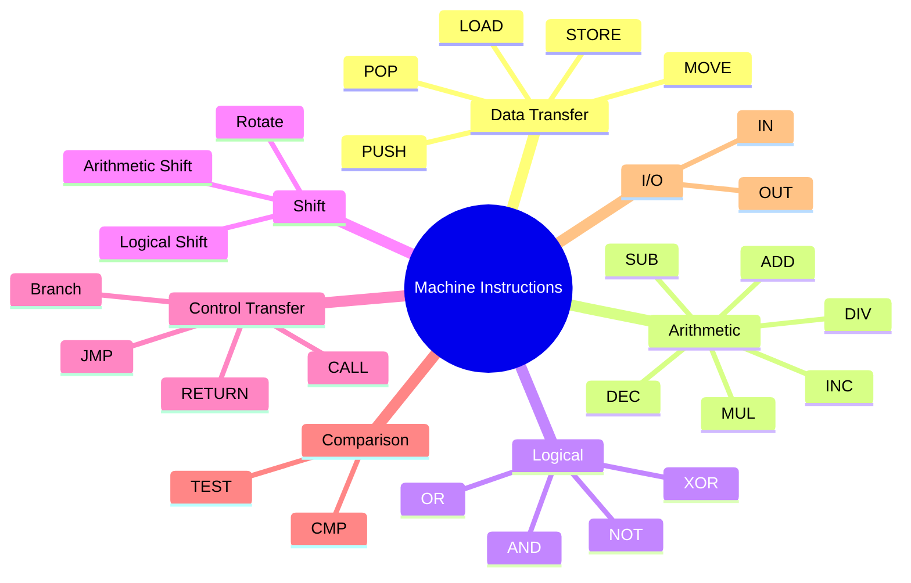
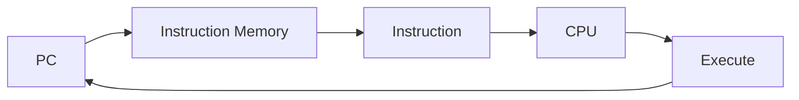
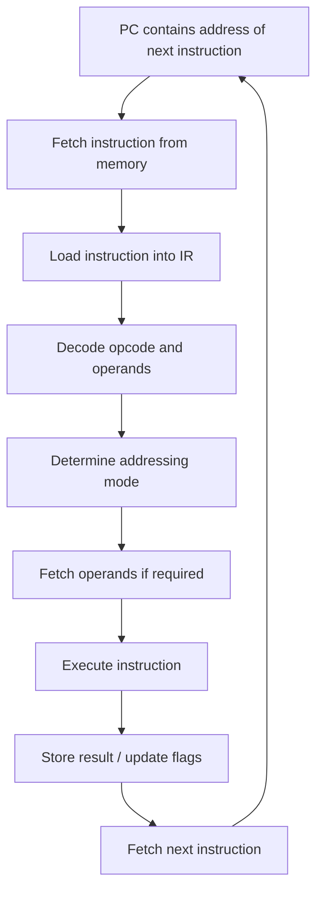
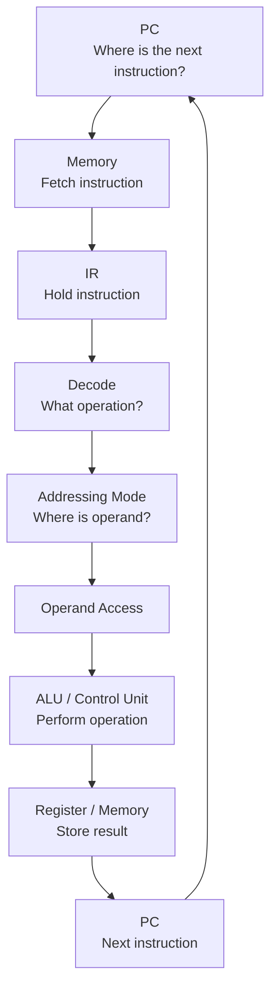

# Machine Instructions

> **Subject:** Computer Organization and Architecture (COA)
> **Exam:** GATE CSE
> **Topic:** Machine Instructions
> **Prerequisite:** Basic Computer Architecture, Binary/Hexadecimal Number System

---

## 1. What is a Machine Instruction?

A **machine instruction** is a binary-coded command that tells the CPU **what operation to perform and on which data**.

The CPU directly understands machine instructions.

For example:

```text
ADD R1, R2
```

Conceptually means:

```text
R1 ← R1 + R2
```

At the hardware level, the instruction is represented using binary bits.

```text
10110001 0010 0101
```

The exact binary representation depends on the **Instruction Set Architecture (ISA)** of the processor.

---

## 2. Machine Instruction vs Assembly Instruction

There are different levels of representation.



### Example

A high-level statement:

```c
x = a + b;
```

may eventually be translated into instructions such as:

```asm
LOAD R1, a
LOAD R2, b
ADD  R1, R2
STORE x, R1
```

The CPU ultimately executes the corresponding machine-code instructions.

---

# 3. Instruction Set

An **Instruction Set** is the collection of machine instructions supported by a processor.

It defines what operations the processor can perform.

Examples include:

* Data transfer
* Arithmetic
* Logical operations
* Control transfer
* Input/Output
* Shift and rotate
* Comparison

The instruction set is a major part of the processor's **Instruction Set Architecture (ISA)**.

---

# 4. Instruction Set Architecture (ISA)

ISA is the interface between **software and hardware**.

It specifies things such as:

* Instructions
* Registers
* Data types
* Addressing modes
* Instruction formats
* Memory addressing
* Exception behavior



### Important GATE Point

> **ISA describes what the processor can do, while the microarchitecture describes how the processor implements it.**

---

# 5. Components of a Machine Instruction

A machine instruction commonly contains:

```text
+----------------+-------------------+
|     Opcode     |     Operand(s)    |
+----------------+-------------------+
```

### Opcode

**Opcode = Operation Code**

It specifies **what operation the CPU should perform**.

Examples:

```text
ADD
SUB
LOAD
STORE
AND
OR
JUMP
```

### Operand

An operand specifies the **data or location of data** involved in the operation.

Operands may refer to:

* Registers
* Memory locations
* Immediate constants
* I/O locations

---

# 6. General Instruction Format

A simplified instruction can be represented as:

```text
+--------+----------+----------+----------+
| Opcode | Operand1 | Operand2 | Operand3 |
+--------+----------+----------+----------+
```

For example:

```text
ADD R1, R2, R3
```

can conceptually mean:

```text
R1 ← R2 + R3
```

Here:

```text
Opcode  = ADD
Operand1 = R1
Operand2 = R2
Operand3 = R3
```

---

# 7. Number of Operands

Instructions can be classified based on the number of explicit operands.

## 7.1 Three-Address Instruction

Example:

```asm
ADD R1, R2, R3
```

Meaning:

```text
R1 ← R2 + R3
```

There are three explicit operands.

```text
Destination = R1
Source 1    = R2
Source 2    = R3
```

### Advantage

The source operands remain unchanged.

### Disadvantage

The instruction requires more bits to encode registers.

---

# 8. Two-Address Instruction

Example:

```asm
ADD R1, R2
```

Meaning:

```text
R1 ← R1 + R2
```

Here `R1` acts as both:

* Source
* Destination

```text
Before:

R1 = 10
R2 = 20

ADD R1, R2

After:

R1 = 30
R2 = 20
```

---

# 9. One-Address Instruction

One-address architectures commonly use an **Accumulator (AC)**.

Example:

```asm
LOAD A
ADD B
STORE C
```

Conceptually:

```text
AC ← M[A]
AC ← AC + M[B]
M[C] ← AC
```

The accumulator is implicitly used as one operand.

---

# 10. Zero-Address Instruction

Zero-address instructions are commonly associated with **stack-based architectures**.

Suppose:

```text
A + B
```

is evaluated using a stack.

```asm
PUSH A
PUSH B
ADD
POP C
```

The `ADD` instruction does not explicitly specify operands.

It operates on the top elements of the stack.



---

# 11. Comparison of Instruction Formats

| Type      | Example        | Main Idea                   |
| --------- | -------------- | --------------------------- |
| 3-address | `ADD R1,R2,R3` | Separate destination        |
| 2-address | `ADD R1,R2`    | Destination is also source  |
| 1-address | `ADD B`        | Accumulator is implicit     |
| 0-address | `ADD`          | Stack operands are implicit |

### GATE Tip

Remember:

```text
3-address → Explicit destination + 2 sources
2-address → Destination + 1 source
1-address → Accumulator implicit
0-address → Stack operands implicit
```

---

# 12. Types of Machine Instructions

Machine instructions can broadly be classified into:



---

# 13. Data Transfer Instructions

Data transfer instructions move data between locations.

Examples:

```asm
LOAD R1, A
STORE A, R1
MOVE R1, R2
```

Conceptually:

```text
LOAD:
R1 ← M[A]

STORE:
M[A] ← R1

MOVE:
R1 ← R2
```

### Important

A data transfer instruction usually **does not change the actual value of the source**.

---

# 14. Arithmetic Instructions

Arithmetic instructions perform numerical operations.

Common examples:

```text
ADD
SUB
MUL
DIV
INC
DEC
```

Example:

```asm
ADD R1, R2
```

means:

```text
R1 ← R1 + R2
```

Another example:

```asm
INC R1
```

means:

```text
R1 ← R1 + 1
```

---

# 15. Logical Instructions

Logical instructions operate on individual bits.

Common operations:

```text
AND
OR
XOR
NOT
```

Example:

```text
A = 1010
B = 1100

A AND B
  = 1000
```

### Truth Table

| A | B | AND | OR | XOR |
| - | - | --- | -- | --- |
| 0 | 0 | 0   | 0  | 0   |
| 0 | 1 | 0   | 1  | 1   |
| 1 | 0 | 0   | 1  | 1   |
| 1 | 1 | 1   | 1  | 0   |

---

# 16. Shift Instructions

Shift instructions move bits left or right.

Common types:

* Logical left shift
* Logical right shift
* Arithmetic right shift
* Rotate

Example:

```text
10110010
```

Logical left shift by 1:

```text
01100100
```

The leftmost bit is discarded and `0` enters from the right.

---

# 17. Control Transfer Instructions

Control transfer instructions change the normal sequential execution of instructions.

Examples:

```text
JMP
BRANCH
CALL
RETURN
```

Normally:

```text
PC ← PC + instruction_length
```

A branch instruction can instead modify the PC:

```text
PC ← Target_Address
```

---

# 18. Program Counter (PC)

The **Program Counter (PC)** stores the address of the next instruction to be fetched.

Conceptually:



During normal sequential execution:

```text
PC ← PC + Instruction Length
```

For a branch/jump:

```text
PC ← Branch Target Address
```

### GATE Important

> PC contains the address of the **next instruction to be fetched**, not generally the current instruction after fetch.

---

# 19. Instruction Register (IR)

The **Instruction Register (IR)** holds the instruction currently being processed/executed by the CPU.

Typical conceptual flow:

```text
Memory
   ↓
IR
   ↓
Decode
   ↓
Execute
```

---

# 20. Instruction Cycle

The CPU repeatedly performs an instruction cycle.

Basic stages:

```text
Fetch → Decode → Execute
```

More detailed representation:


Not every architecture uses exactly these stages.

---

# 21. Fetch Phase

During fetch, the CPU obtains the instruction from memory.

Conceptually:

```text
IR ← Memory[PC]
PC ← PC + instruction_length
```

The exact timing and micro-operations depend on the processor architecture.

### Example

Suppose:

```text
PC = 1000
Instruction length = 4 bytes
```

After sequential instruction fetch:

```text
PC = 1004
```

---

# 22. Decode Phase

The Control Unit interprets the instruction.

It determines:

* Opcode
* Operand information
* Addressing mode
* Required control signals

Example:

```text
ADD R1, R2
```

The CPU identifies:

```text
Operation = ADD
Source     = R2
Destination = R1
```

---

# 23. Execute Phase

The CPU performs the required operation.

For:

```asm
ADD R1, R2
```

the ALU performs:

```text
R1 + R2
```

and the result is written according to the architecture.

---

# 24. Complete Instruction Flow



---

# 25. Instruction Length

Instruction length is the number of bits/bytes occupied by an instruction.

Examples:

```text
8-bit instruction
16-bit instruction
32-bit instruction
64-bit instruction
```

Architectures can use:

### Fixed-Length Instructions

All instructions have the same size.

Example:

```text
Instruction 1 → 32 bits
Instruction 2 → 32 bits
Instruction 3 → 32 bits
```

### Variable-Length Instructions

Instructions can have different sizes.

Example:

```text
Instruction 1 → 1 byte
Instruction 2 → 3 bytes
Instruction 3 → 5 bytes
```

---

# 26. Fixed vs Variable Length

| Feature             | Fixed Length | Variable Length |
| ------------------- | ------------ | --------------- |
| Instruction size    | Same         | Different       |
| Decode              | Easier       | More complex    |
| Hardware design     | Simpler      | More complex    |
| Code density        | May be lower | Can be higher   |
| Typical association | RISC         | CISC            |

### Important

RISC and CISC are architectural design philosophies. The fixed/variable distinction is a useful general association, but it is **not an absolute rule**.

---

# 27. Instruction Execution Example

Consider:

```asm
ADD R1, R2
```

Suppose:

```text
R1 = 10
R2 = 20
```

Execution:

```text
Before:

R1 = 10
R2 = 20

        ↓

ADD R1, R2

        ↓

R1 = R1 + R2

        ↓

R1 = 30
R2 = 20
```

---

# 28. Machine Instruction and Memory

Suppose the instruction is stored starting at address `1000`.

```text
Memory

1000 → Instruction
1001 → Instruction
1002 → Instruction
1003 → Instruction
```

If the instruction occupies 4 bytes:

```text
PC = 1000
```

After fetching:

```text
PC = 1004
```

This assumes sequential execution and byte-addressable memory.

---

# 29. Instruction Addressing

An instruction may need to identify:

```text
Where is the operand?
```

The operand could be:

```text
Inside instruction
       OR
Register
       OR
Memory
```

This is where **addressing modes** become important.

Examples:

```asm
MOV R1, #10       → Immediate
MOV R1, [1000]    → Direct-style memory reference
MOV R1, R2        → Register
MOV R1, [R2]      → Register indirect
```

The exact syntax depends on the ISA.

---

# 30. Opcode and Instruction Size

Suppose an instruction contains:

```text
Opcode + Address
```

and total instruction size is 16 bits.

If:

```text
Opcode = 6 bits
```

then:

```text
Address field = 16 - 6
              = 10 bits
```

Therefore the address field can represent:

```text
2^10 = 1024
```

different bit patterns.

### General Formula

If a field contains `n` bits:

```text
Number of possible values = 2^n
```

---

# 31. GATE Numerical Concept

Suppose an instruction format has:

```text
Instruction size = 32 bits
Opcode           = 8 bits
Register 1       = 5 bits
Register 2       = 5 bits
```

Remaining bits:

```text
32 - 8 - 5 - 5
= 14 bits
```

Therefore, the remaining field can represent:

```text
2^14
```

different values.

---

# 32. Important GATE Concepts

### Remember these:

1. **Opcode identifies the operation.**
2. **Operands identify data or locations involved in the operation.**
3. **PC stores the address of the next instruction to be fetched.**
4. **IR stores the current instruction being processed.**
5. **Instruction cycle broadly consists of fetch, decode and execute.**
6. **Addressing mode determines how an operand/effective address is obtained.**
7. **Three-address instructions usually require more instruction bits than one-address instructions when operand fields are explicitly encoded.**
8. **Zero-address instructions are associated with stack-based execution.**
9. **One-address instructions commonly use an accumulator.**
10. **Control-transfer instructions can change the PC.**

---

# 33. Common GATE Traps

## Trap 1 — PC confusion

Incorrect:

```text
PC always stores the current instruction.
```

Better:

```text
PC normally contains the address of the next instruction to be fetched.
```

---

## Trap 2 — IR confusion

```text
PC → address
IR → instruction
```

Remember:

```text
PC = Program Counter
IR = Instruction Register
```

---

## Trap 3 — Opcode vs Operand

```text
Opcode → What operation?
Operand → On what data/location?
```

---

## Trap 4 — Number of operands

Do not confuse:

```text
Number of operands
```

with:

```text
Number of memory accesses
```

They are not necessarily the same.

---

# 34. Quick Revision

```text
Machine Instruction
        │
        ├── Opcode
        │
        └── Operand(s)
```

### Instruction Types

```text
Data Transfer
Arithmetic
Logical
Shift
Control Transfer
Comparison
I/O
```

### Operand Formats

```text
3-address
2-address
1-address
0-address
```

### Basic Instruction Cycle

```text
Fetch
  ↓
Decode
  ↓
Execute
  ↓
Next Instruction
```

### Important Registers

```text
PC → Address of next instruction
IR → Current instruction
```

---

# 35. GATE Formula Sheet

### Number of combinations

For `n` bits:

```text
Number of possible values = 2^n
```

### Addressable locations

If address field contains `n` bits:

```text
Number of addressable locations = 2^n
```

### Address field

```text
Address bits
=
Instruction bits
− Opcode bits
− Other field bits
```

### Sequential PC update

For byte-addressable memory:

```text
Next PC = Current PC + Instruction Length in bytes
```

---

# 36. Self-Test Questions

### Q1

An instruction contains 32 bits. The opcode occupies 8 bits. How many bits remain for operands?

```text
32 - 8 = 24 bits
```

**Answer: 24 bits**

---

### Q2

A processor has a 16-bit address field. How many different addresses can it represent?

```text
2^16 = 65,536
```

**Answer: 65,536**

---

### Q3

Which register normally contains the address of the next instruction?

```text
PC
```

**Answer: Program Counter**

---

### Q4

Which register holds the instruction currently being processed?

```text
IR
```

**Answer: Instruction Register**

---

### Q5

Which instruction format commonly uses an accumulator implicitly?

```text
One-address instruction
```

---

### Q6

Which instruction format commonly uses stack operands implicitly?

```text
Zero-address instruction
```

---

# 37. One-Page Mental Model

Think of the CPU executing an instruction like this:



The key questions are:

```text
PC
 ↓
WHERE is the instruction?

IR
 ↓
WHAT instruction is being processed?

Opcode
 ↓
WHAT operation should be performed?

Addressing Mode
 ↓
WHERE/HOW is the operand obtained?

ALU / CPU
 ↓
PERFORM the operation

Result
 ↓
WHERE should the result go?
```

---

# 38. Next Topic

After understanding machine instructions, study:

```text
01_machine_instructions.md
        ↓
02_instruction_set_architecture.md
        ↓
03_instruction_format.md
        ↓
04_opcode_and_operand.md
        ↓
05_instruction_types.md
        ↓
06_instruction_cycle.md
        ↓
10_addressing_modes.md
```

> **GATE Focus:** Don't just memorize instruction definitions. Practice calculating **instruction fields, address ranges, instruction sizes, PC values, number of operands, and memory/addressing-related quantities**.
